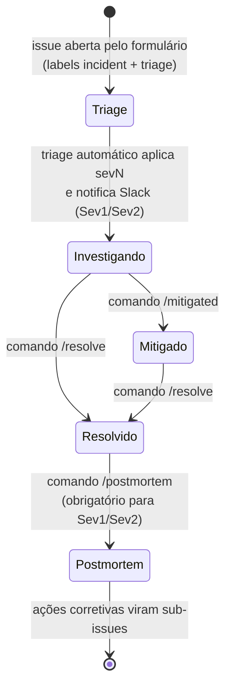
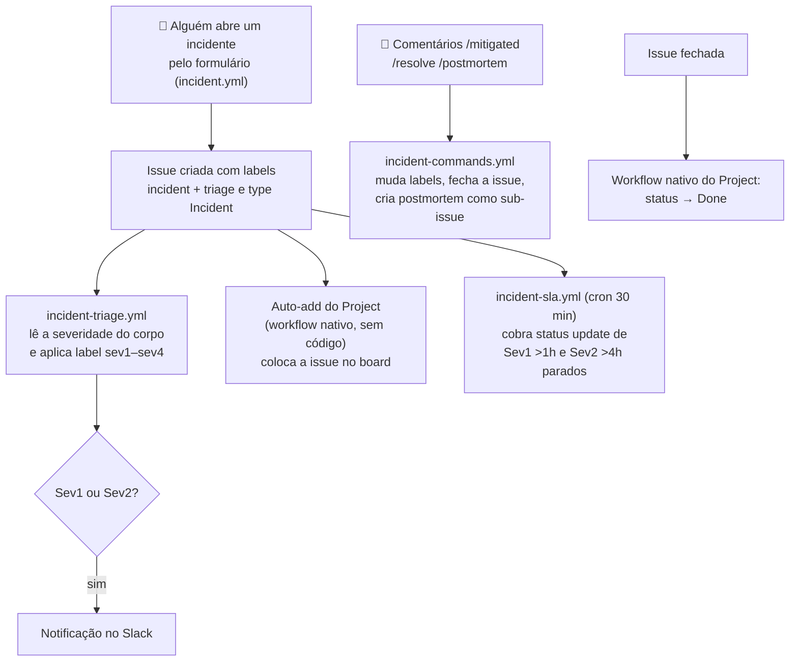

# Visão geral: como o sistema funciona

## O que é

Um sistema de gestão de incidentes construído **inteiramente sobre recursos nativos do GitHub** — Issues, Projects v2 e Actions — seguindo o padrão [IssueOps](https://github.blog/engineering/issueops-automate-ci-cd-and-more-with-github-issues-and-actions/). Não há servidor, banco de dados nem serviço externo obrigatório: o estado do incidente vive na issue, a automação roda em Actions e o acompanhamento é feito em um Project.

A decisão de usar GitHub (e suas alternativas, limitações e a evolução futura para
multi-cliente com GitHub App) está documentada no
[estudo de viabilidade](../estudo-github-gestao-de-incidentes.md).

## Modelo de dados

| Conceito do incidente | Recurso do GitHub |
|---|---|
| Incidente | Issue (com issue type `Incident`) |
| Severidade | Label `sev1`–`sev4`, aplicada automaticamente a partir do formulário |
| Estado operacional | Labels (`triage`, `mitigated`) + estado da issue (aberta/fechada) + campo `Status` no Project |
| Linha do tempo / audit trail | Timeline nativa da issue (comentários, labels, atribuições — tudo com timestamp e autor) |
| Ações corretivas e postmortem | Sub-issues do incidente |
| Painel consolidado | Project v2 org-level com views por severidade, cliente e status |
| Cliente (Sunny Systems) | Um repositório `incidents-<cliente>` por cliente |

## Ciclo de vida de um incidente

Durante toda a fase aberta, o workflow de SLA (`incident-sla.yml`) roda a cada 30
minutos e cobra atualização de status em Sev1 parado há mais de 1h e Sev2 há mais
de 4h.

## O que acontece automaticamente

## Papéis

- **Quem reporta** (cliente ou time interno): abre a issue pelo formulário. Só precisa
  de acesso de leitura/escrita de issues no repo do cliente.
- **Quem responde** (on-call/engenharia Sunny): investiga, comenta status updates na
  issue (a timeline é o registro oficial), usa os comandos `/mitigated`, `/resolve`
  e `/postmortem`.
- **Gestão**: acompanha pelo Project org-level "Incident Response" — views por
  severidade, cliente e status; Insights para gráficos.

## Componentes do repositório

| Caminho | Papel |
|---|---|
| `.github/ISSUE_TEMPLATE/incident.yml` | Formulário de abertura de incidente |
| `.github/ISSUE_TEMPLATE/postmortem.yml` | Formulário de postmortem (abertura manual) |
| `.github/ISSUE_TEMPLATE/config.yml` | Bloqueia issues em branco (força o uso do formulário) |
| `.github/workflows/incident-triage.yml` | Triage automático na abertura |
| `.github/workflows/incident-commands.yml` | Comandos por comentário |
| `.github/workflows/incident-sla.yml` | Cobrança de SLA via cron |
| `.github/workflows/incident-ingest.yml` | Ingestão de alertas do monitoramento (dedup por fingerprint) |
| `scripts/setup-labels.sh` | Provisionamento das labels padrão |

Detalhes de cada arquivo: [Referência técnica](04-referencia-tecnica.md).

## Princípios de desenho

1. **A issue é a fonte de verdade.** Tudo que importa para o postmortem deve estar
   na timeline da issue, não em DMs do Slack.
2. **Automação leve e substituível.** Os workflows usam apenas `GITHUB_TOKEN` e
   `actions/github-script`; nenhum vendor lock-in além do próprio GitHub.
3. **Configuração de projeto sem código.** Entrada no board e status Done usam os
   workflows nativos do Projects, não Actions.
4. **Pronto para multi-cliente.** Este repo é um template: cada cliente ganha um
   repo `incidents-<cliente>` idêntico, e o Project org-level consolida tudo.
   A fase 3 (GitHub App + dashboard) está descrita no estudo, seção 4.
