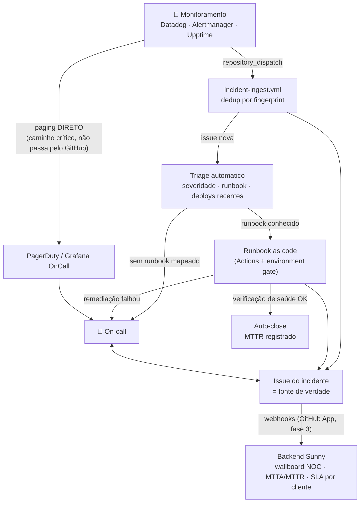

# NOC automatizado sobre o kit

Como evoluir o sistema de gestão de incidentes para um NOC (Network Operations
Center) automatizado: alertas abrem incidentes sozinhos, runbooks executam como
código com gate de aprovação, e o humano entra apenas onde decide melhor que a
máquina.

O kit atual já resolve a parte mais difícil de um NOC — **processo e registro
disciplinados**. Os níveis abaixo são incrementais sobre ele; cada um entrega
valor sozinho.

## Arquitetura alvo



### Princípio inegociável: o paging não passa pelo GitHub

Latência de fila do Actions (segundos a minutos) e o risco de outage do próprio
GitHub são aceitáveis para registro e orquestração — **não** para acordar alguém
às 3h da manhã. O monitoramento pagea o on-call **diretamente** (PagerDuty/
Grafana OnCall) e, em paralelo, abre o incidente no GitHub. O GitHub é o cérebro
do NOC, não o nervo.

## Escada de maturidade

| Nível | Capacidade | O que muda | Status |
|---|---|---|---|
| 0 | Registro disciplinado | Humano abre, humano resolve, GitHub registra | ✅ kit atual |
| 1 | Detecção automática | Monitoramento abre/deduplica incidentes | ✅ `incident-ingest.yml` |
| 2 | Triage e escalonamento | Enriquecimento, on-call auto-atribuído, escalonamento | parcial — acionamento/escalonamento ✅ (adapter `page-oncall`); enriquecimento pendente (diagnóstico pode vir do [RootPilot](08-integracao-rootpilot.md)) |
| 3 | Auto-remediação | Runbooks as code com gate de aprovação | próximo |
| 4 | IA no loop | Agente analisa, correlaciona e rascunha postmortem | futuro — candidato natural: [RootPilot F3](08-integracao-rootpilot.md) |

---

## Nível 1 — Detecção automática (implementado)

O workflow [`incident-ingest.yml`](../.github/workflows/incident-ingest.yml)
recebe alertas via `repository_dispatch` e:

1. **Deduplica por fingerprint** — cada alerta carrega um identificador estável
   (ex.: `api-prod-high-5xx`), gravado como comentário HTML invisível no corpo da
   issue. Alerta repetido vira comentário no incidente aberto, não issue nova —
   uma tempestade de alertas não vira tempestade de issues.
2. **Cria a issue completa** — labels `incident` + `sevN` + `triage`, corpo com
   origem, serviço, severidade e link do alerta.
3. **Notifica o Slack** em Sev1/Sev2.
4. **Trata normalização** — `status: resolved` comenta na issue que o alerta
   normalizou na origem (não fecha sozinho: fechar é decisão do nível 3, após
   verificação).

Contrato do payload e exemplo de `curl` no cabeçalho do próprio workflow;
detalhes na [referência técnica](04-referencia-tecnica.md#incident-ingestyml).

### Integrando as ferramentas de monitoramento

| Ferramenta | Como |
|---|---|
| **Datadog** | Webhooks integration suporta payload JSON customizado e headers — chama a API `dispatches` do GitHub direto, sem intermediário |
| **Prometheus Alertmanager** | O payload do `webhook_configs` tem formato fixo; use um relay de ~20 linhas (Lambda/Cloudflare Worker) que converte para o contrato do `repository_dispatch` |
| **Upptime** | Já abre issues nativamente; alinhe as labels do config (`incident`) para cair no mesmo fluxo |
| **CloudWatch / outros** | SNS → Lambda → API `dispatches` |

> **Gotcha importante do Actions**: issues criadas com o `GITHUB_TOKEN` **não
> disparam** outros workflows (prevenção de recursão). Por isso o ingest aplica a
> label de severidade e notifica o Slack ele mesmo, em vez de delegar ao
> `incident-triage.yml`. A exceção documentada são os eventos `workflow_dispatch`
> e `repository_dispatch` — que é exatamente o mecanismo usado no nível 3 para
> encadear runbooks.

O token usado pelo monitoramento para chamar `dispatches` deve ser de escopo
mínimo: fine-grained PAT (ou instalação da GitHub App na fase 3) com permissão
somente de `contents: read` + `metadata` no repo do cliente.

---

## Nível 2 — Triage, enriquecimento e escalonamento

### Acionamento de on-call (implementado)

O acionamento é feito pelo composite action
[`page-oncall`](../.github/actions/page-oncall/action.yml) — uma **camada
adaptadora** com contrato único (`trigger`/`resolve` + severidade + dedup-key)
que traduz para o provedor configurado por repo de cliente: **GoAlert** (default
da Sunny), **PagerDuty** ou **Opsgenie**. Trocar de provedor = trocar
`PAGING_PROVIDER`/`PAGING_KEY` no repo; nenhum workflow muda. Detalhes na
[referência técnica](04-referencia-tecnica.md#acionamento-de-on-call--action-page-oncall).

**Decisão de ferramenta (11/07/2026):**

- **Grafana OnCall OSS — descartado**: AGPL-3.0 e, decisivo, projeto **arquivado
  em 24/03/2026** (a Cloud Connection que dava SMS/telefone/push ao OSS parou na
  mesma data).
- **GoAlert (Target) — escolhido para empacotar**: Apache-2.0 (permissiva —
  pode embutir na oferta da Sunny, modificar e manter privado; se o Target
  abandonar, forka-se), ativamente mantido, battle-tested, faz escala +
  escalonamento + SMS/voz via Twilio. Uma instância única da Sunny, um *service*
  (integration key) por cliente/criticidade.
- **Pager próprio — nunca**: commodity safety-critical fora do moat; um bug =
  Sev1 perdido às 3h.
- **PagerDuty/Opsgenie** ficam como opção *por cliente* que já os tem (Opsgenie
  morre em abril/2027 — não usar em cliente novo).

**Divisão de responsabilidade**: o kit dispara **uma vez** por incidente
(abertura humana Sev1/Sev2 no triage; alerta ingerido no ingest) e resolve no
fechamento; **cadeia de escalonamento, repetição e ack são política do
provedor** — não reimplementamos escalonamento em cron. O caminho crítico
continua sendo monitoramento → provedor direto; o acionamento via Actions cobre
o caso do incidente que **nasce no GitHub** (formulário), onde já há um humano
acordado abrindo a issue e a latência de fila do Actions é aceitável.

### Enriquecimento (próximo)

- **Runbook e contexto na issue**: um arquivo `runbooks/index.yml` no repo mapeia
  serviço → runbook/dashboard; o triage comenta os links e os últimos deploys
  (`git log`/PRs merged nas últimas 24h — os suspeitos naturais).
- **Atribuição do on-call**: o triage busca quem está de plantão na API do
  provedor (GoAlert tem API GraphQL) e faz o assign na issue, para o board
  refletir o dono.

### War-room Slack bidirecional (próximo — gap identificado no benchmark Rootly)

Hoje o Slack do kit é one-way (notificação). O
[benchmark com a Rootly](09-benchmark-rootly.md) apontou este como o gap de
maior fricção operacional: durante um Sev1/Sev2, a coordenação em tempo real
acontece no Slack, e sem canal dedicado o registro se dispersa.

Desenho da implementação (step novo no `incident-triage.yml`/`incident-ingest.yml`
para Sev1/Sev2):

1. **Criar o canal** `#inc-<numero>-<slug>` via `conversations.create` — exige um
   **Slack bot token** (`SLACK_BOT_TOKEN`, escopos `channels:manage`,
   `chat:write`, `channels:read`), não o incoming webhook atual.
2. **Convidar** o on-call (mapeamento GitHub↔Slack em arquivo no repo) e postar o
   contexto: link da issue, severidade, runbook.
3. **Cruzar os registros**: comentar o link do canal na issue; postar na criação
   do canal que a issue é a fonte de verdade.
4. **No `/resolve`**: postar o encerramento no canal e arquivá-lo
   (`conversations.archive`).
5. **Fora do escopo do kit** (fica para o backend fase 3 ou para o RootPilot):
   scribe automático do canal de volta para a issue — sincronizar Slack→issue
   exige um bot ouvindo eventos, não um workflow.

Princípio mantido: **a issue continua sendo a fonte de verdade**; o canal é
espaço de coordenação, e decisões/descobertas devem ser resumidas na issue
(disciplina do [guia de uso](03-guia-de-uso.md)).

## Nível 3 — Auto-remediação (runbooks as code)

O coração do NOC automatizado: o runbook deixa de ser um documento e vira um
workflow versionado, revisado por PR e auditado pela execução.

**Regras de segurança:**

1. Auto-remediação **somente para playbooks conhecidos** — alerta sem runbook
   mapeado escala para humano.
2. Ações arriscadas passam por **environment com required reviewers**: o run
   pausa até um SRE aprovar (padrão "ApproveOps"). Runbooks comprovadamente
   seguros (ex.: restart idempotente) usam um environment sem reviewers.
3. Credenciais via **OIDC** (`id-token: write`) — nenhum secret de nuvem de longa
   duração no repositório.
4. Toda execução **reporta o resultado na issue** — a auditoria é a timeline.

**Exemplo completo** — runbook de restart com gate de aprovação, verificação de
saúde e auto-close:

```yaml
name: "Runbook: restart API"

on:
  workflow_dispatch:            # encadeável pelo ingest/triage via API
    inputs:
      issue_number:
        description: Número da issue do incidente
        required: true
  issues:
    types: [labeled]            # ou por humano aplicando a label runbook:restart-api

permissions:
  issues: write
  id-token: write               # OIDC para autenticar na nuvem

jobs:
  remediate:
    if: >-
      github.event_name == 'workflow_dispatch' ||
      github.event.label.name == 'runbook:restart-api'
    runs-on: ubuntu-latest
    environment: producao-remediacao   # required reviewers = gate de aprovação humana
    env:
      ISSUE: ${{ github.event_name == 'workflow_dispatch'
                 && inputs.issue_number
                 || github.event.issue.number }}
    steps:
      - name: Autenticar na AWS via OIDC
        uses: aws-actions/configure-aws-credentials@v4
        with:
          role-to-assume: arn:aws:iam::123456789012:role/noc-remediation
          aws-region: us-east-1

      - name: Reiniciar o serviço
        run: aws ecs update-service --cluster prod --service api --force-new-deployment

      - name: Verificar saúde (até 5 min)
        id: health
        run: |
          for i in $(seq 1 30); do
            if curl -fsS https://api.cliente.com/health > /dev/null; then
              echo "healthy=true" >> "$GITHUB_OUTPUT"; exit 0
            fi
            sleep 10
          done
          echo "healthy=false" >> "$GITHUB_OUTPUT"

      - name: Reportar resultado na issue
        if: always()
        uses: actions/github-script@v7
        with:
          script: |
            const issue = {
              owner: context.repo.owner,
              repo: context.repo.repo,
              issue_number: Number(process.env.ISSUE),
            };
            const healthy = '${{ steps.health.outputs.healthy }}' === 'true';
            const runUrl = `${context.serverUrl}/${context.repo.owner}/${context.repo.repo}/actions/runs/${context.runId}`;

            if (healthy) {
              await github.rest.issues.createComment({
                ...issue,
                body: `🤖 Runbook **restart-api** executado com sucesso — health check OK. [Log da execução](${runUrl})`,
              });
              await github.rest.issues.update({ ...issue, state: 'closed', state_reason: 'completed' });
            } else {
              await github.rest.issues.addLabels({ ...issue, labels: ['needs-human'] });
              await github.rest.issues.createComment({
                ...issue,
                body: `🤖⚠️ Runbook **restart-api** executado, mas o health check NÃO normalizou. Escalando para humano. [Log](${runUrl})`,
              });
            }
```

**Como o runbook é acionado automaticamente**: o ingest (ou triage) mantém um
mapa `fingerprint → runbook` e chama
`github.rest.actions.createWorkflowDispatch(...)` — `workflow_dispatch` é uma das
duas exceções à regra de recursão do `GITHUB_TOKEN`, então o encadeamento
funciona. O acionamento manual (humano aplica a label `runbook:restart-api`)
também funciona, e é o modo recomendado de rodagem assistida antes de confiar a
automação total.

**Começando**: escolha os 2–3 alertas mais frequentes dos últimos meses cujo
runbook é mecânico (restart, rollback, limpeza de fila, failover de réplica).
Rode assistido (label manual + gate) por algumas semanas; promova a automático
(dispatch + environment sem reviewer) quando a taxa de sucesso comprovar.

## Nível 4 — IA no loop

Como cada incidente é uma issue com timeline estruturada, um agente tem contexto
completo e auditável para:

- **Análise inicial**: ler o alerta, correlacionar com deploys e mudanças
  recentes no código, comentar hipóteses antes do humano chegar (Claude Code no
  Actions, Copilot coding agent atribuído à issue, ou GitHub Agentic Workflows).
- **Rascunho de postmortem**: gerar a linha do tempo e o resumo a partir da
  timeline da issue ao rodar `/postmortem` — o humano revisa em vez de redigir.
- **Sugestão de runbook**: para alertas sem playbook, propor o diagnóstico com
  base em incidentes semelhantes já resolvidos (o histórico de issues é o
  dataset).

Mesma regra do nível 3: agente **comenta e propõe**; ação destrutiva passa pelo
gate de aprovação.

> Para os níveis 2 e 4, o candidato natural é o **RootPilot** da própria Sunny
> (`investigate_incident` + auto-diagnóstico por webhook): credenciais ficam na
> infra do cliente e cada investigação melhora as próximas. Mapeamento completo,
> fluxo integrado e pré-requisitos em
> [08 — Integração com o RootPilot](08-integracao-rootpilot.md).

## Métricas do NOC (fase 3 / backend)

Com os webhooks de `issues` e `projects_v2_item` fluindo para o backend da
GitHub App, o wallboard do NOC mede:

| Métrica | Fonte |
|---|---|
| **MTTA** (tempo até 1ª resposta) | `issues.opened` → 1º comentário humano/assign |
| **MTTR** (tempo até resolução) | `issues.opened` → `issues.closed` |
| **Taxa de auto-remediação** | Incidentes fechados por runbook ÷ total |
| **Ruído de alertas** | Incidentes deduplicados + resolvidos em <15 min |
| **SLA por cliente/contrato** | Timestamps acima segmentados por repositório |

## Roadmap incremental sugerido

1. **Agora**: subir o GoAlert da Sunny (Postgres + binário + Twilio), criar
   services/escalas, configurar `PAGING_*` nos repos; paging direto
   monitoramento → GoAlert para alertas de máquina (independe do GitHub);
   apontar Datadog/Alertmanager para o `incident-ingest.yml`.
2. **+2 semanas**: enriquecimento do triage (runbooks/index.yml, deploys recentes,
   assign do on-call via API do provedor) e **war-room Slack** (canal automático
   em Sev1/Sev2 com bot token, arquivado no `/resolve`).
3. **+1 mês**: 2–3 runbooks as code em modo assistido; environment
   `producao-remediacao` com required reviewers.
4. **+2 meses**: promoção dos runbooks estáveis a automático; backend fase 3 com
   wallboard e métricas.
5. **Depois**: agente de IA no triage e no postmortem.
