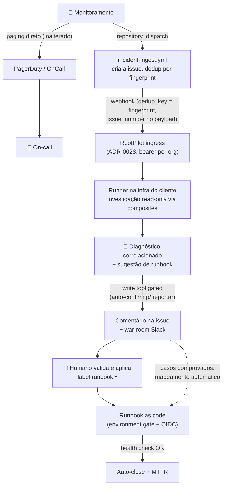

# Integração com o RootPilot — diagnóstico automático no NOC

Como o RootPilot (`sunnysystems/rootpilot`) supre os níveis 2 e 4 da
[escada do NOC automatizado](07-noc-automatizado.md), quais integrações precisam
existir e o que fica deliberadamente fora dele.

> Baseado na análise do repositório em **11/07/2026** (README, `docs/product/vision.md`
> e ADRs — repo privado; links exigem acesso). O RootPilot está em fase de fundação;
> revisitar este doc quando a PRD-022 for entregue.

## O que é o RootPilot (findings)

Plataforma de **infra intelligence** da Sunny Systems, derivado comercial do
infraintel (motor já em produção em cliente real). Agrega a stack de infra +
produto (AWS, Datadog, GitHub, Jira, SonarQube, Slack, Amplitude) numa interface
de alto nível para agentes: em vez de o LLM orquestrar 8 MCPs crus, chama
**composites** — `investigate_incident`, `get_deploy_impact` — que cruzam os
sistemas e devolvem contexto **já correlacionado**.

**Arquitetura** (ADR-0001): *runner* efêmero na infra do cliente (guarda as
credenciais, executa somente leitura, redige PII na borda) conectado por WSS
reverso/mTLS ao *control plane* SaaS (orquestração, UI, billing e a inteligência
cross-tenant). Tese de produto: **as credenciais do cliente nunca saem da infra
dele; a inteligência cross-tenant nunca sai da Sunny.**

**Achado central — ADR-0028** (aceito em 08/07/2026, PRD-022, "Auto-diagnóstico
por webhook"): alerta de plataforma de incidentes (PagerDuty/Opsgenie/Datadog/
Grafana/Alertmanager) chega por webhook e dispara investigação automática,
entregue no war-room. É literalmente o "primeiro respondedor" do NOC. Pontos do
desenho que importam para a integração:

| Aspecto | Decisão do ADR-0028 |
|---|---|
| Auth do ingress | Bearer-token na URL, sha256 persistido, 1 token por org; assinatura por-provider (`verifySignature`) como defesa em profundidade |
| Isolamento de tenant | O orchestrator só alcança o runner **daquela** org (herdado do ADR-0001) |
| Dedup | Por `(provider, dedup_key)` — plataformas fazem retry/re-notify |
| Seletividade | Filtro per-tenant por severidade/serviço; feature-flag **default-off**; quota (investigations = métrica de custo/pricing) |
| Investigação | **Somente leitura** — AWS/Datadog/GitHub nunca escrevem, inviolável |
| Entrega | Write tools gated (ADR-0015/0018): auto-confirm **só para reportar** (Slack war-room, comentário em ticket) |
| Ação corretiva | **Fora de escopo por design** — exigiria ADR próprio + HITL |
| Execução | Row com state-machine (`pending → dispatched → done/failed`); precisa de **runner vivo** para despachar |
| F3 (loop autônomo) | Loop multi-turn sobre ~11 composites read-only, com teto de tool-calls/tokens/timeout; opt-in (`INCIDENT_AGENT_LOOP`), coexiste com o plano fixo barato (F2) |
| Aprendizado | Cada investigação vira `session_trace` e alimenta o loop de reflexão (ADR-0008) — o flywheel melhora o diagnóstico com o tempo |

Outros ADRs relevantes para esta integração: ADR-0013 (superfície MCP/agente),
ADR-0015/0018 (write tools + gate `confirmed`/HITL), ADR-0006 (open-core: runner
+ connectors abertos, cérebro fechado), ADR-0007 (SDK de connectors de terceiros).

## Mapeamento na escada do NOC

| Nível do NOC | O RootPilot supre? | Detalhe |
|---|---|---|
| 0 — Registro | ❌ | Continua no kit (issue = fonte de verdade). O RootPilot inclusive usa a mesma convenção internamente (PRDs como issues) |
| 1 — Detecção | ⚠️ Sobrepõe | O ingress do ADR-0028 e o `incident-ingest.yml` recebem os mesmos alertas; alinhar a chave de dedup (ver topologia abaixo) |
| 2 — Triage e enriquecimento | ✅ **Quase inteiro** | O que o doc 07 descreve como "comentar runbook, dashboards e deploys recentes" é a versão artesanal do `investigate_incident`: primeiro diagnóstico correlacionado em ~2 min, comprimindo o MTTA — o "primeiro status update" passa a ser produzido por máquina |
| 3 — Auto-remediação | ❌ **Por design** | Diagnóstico é read-only; corretiva é HITL e fora de escopo. A execução continua nos runbooks as code do kit (OIDC + environment gate) |
| 4 — IA no loop | ✅ **É o F3** | O loop autônomo do ADR-0028 é o agente que o doc 07 marcava como "futuro" — e resolve o que um "Claude no Actions" caseiro não resolve (ver abaixo) |

### Por que o RootPilot em vez de um agente caseiro no Actions (nível 4)

1. **Credenciais**: o runner fica na infra do cliente — nada de API keys de
   AWS/Datadog do cliente em secrets do GitHub da Sunny. O agente caseiro
   exigiria exatamente esse honeypot.
2. **Aprendizado**: o `session_trace` de cada investigação alimenta o flywheel
   cross-tenant — o equivalente à "experiência acumulada do plantonista", o
   ativo mais difícil de construir num NOC. Um agente stateless no Actions
   recomeça do zero a cada incidente.
3. **Guardrails prontos**: toolset curado read-only, budget de tool-calls/tokens,
   timeout, PII redigida na borda — a mesma filosofia de bounded autonomy dos
   runbooks do kit.

## Fluxo integrado

**Topologia escolhida — GitHub como hub**: o `incident-ingest.yml` (ou o backend
da fase 3) repassa o alerta ao webhook do RootPilot, em vez de o monitoramento
fazer fan-out para os dois. Motivos: o fingerprint do kit vira o `dedup_key` do
RootPilot (correlação diagnóstico → issue fica determinística), a issue carrega o
`issue_number` para a entrega, e o filtro de severidade fica num lugar só. O
fan-out direto no monitoramento funcionaria sem código novo, mas a correlação
diagnóstico → issue ficaria frouxa (humano ligando os pontos via Slack).

## Pré-requisitos de integração (em ordem de esforço)

1. **Adapter `github` no ingress do RootPilot** — a interface por provider é
   contract-first com `verifySignature(rawBody, headers, secret?)`, e webhook de
   GitHub tem HMAC (`X-Hub-Signature-256`): encaixa no desenho existente do
   ADR-0028 sem mudança estrutural. Alternativa imediata sem código: chamar o
   ingress genérico a partir do `incident-ingest.yml` com o bearer da org.
2. **Write tool de comentário em issue do GitHub** — hoje a entrega gated é
   Jira/Slack; comentar issue é o mesmo padrão "auto-confirm só para reportar"
   do ADR-0015/0018, e o GitHub já está entre os connectors de leitura.
3. **Contrato de correlação** — payload do kit → RootPilot leva `fingerprint`
   (como `dedup_key`), `issue_number`, `repo`, `severity`, `service`. Formalizar
   quando a PRD-022 definir o shape do `IncidentEvent` (que é CP-only,
   `lib/incidents/` — não entra no protocol do edge).

## Alinhamento operacional

- **Seletividade e custo**: investigations são a métrica de quota/pricing do
  RootPilot. Configurar o filtro per-tenant para investigar só **Sev1/Sev2**; o
  dedup do kit já corta alertas repetidos antes de virarem investigations pagas.
- **Modo degradado**: o dispatch exige **runner vivo**; sem runner conectado o
  incidente fica `pending` (degrada, não falha). Registrar no runbook do NOC:
  "diagnóstico automático indisponível → triage manual do nível 2 clássico".
  O paging direto e o registro no GitHub não dependem do RootPilot.
- **Feature-flag default-off**: a ativação é por org — o rollout por cliente do
  NOC acompanha o onboarding do runner daquele cliente.
- **SLA do primeiro update**: com o diagnóstico em ~2 min, o `incident-sla.yml`
  pode passar a cobrar o primeiro update **humano** (validação do diagnóstico),
  não a primeira informação.

## Divisão de domínios de confiança

A separação diagnóstico/remediação não é lacuna — é a arquitetura de segurança:

| Domínio | Quem | Credenciais | Escopo |
|---|---|---|---|
| **Diagnóstico** | RootPilot (runner na infra do cliente) | Nunca saem da infra do cliente (STS/OAuth revogável) | Somente leitura, inviolável |
| **Remediação** | Runbooks as code (Actions do kit) | OIDC por environment, com required reviewers | Escrita, gated por humano |
| **Registro** | GitHub Issues | `GITHUB_TOKEN` efêmero | Issues do repo do cliente |

O RootPilot nunca escreve na infra; as credenciais de remediação nunca passam
pelo RootPilot. Um comprometimento de um domínio não alcança o outro.

## Sinergia comercial

- Cada cliente do NocPilot é um **tenant candidato** do RootPilot; o NOC vira
  canal de distribuição — o cliente que já reporta incidentes no repo dele recebe
  o diagnóstico automático como upgrade (tier Team/Business, quota de
  investigations).
- O modelo de isolamento é congruente: repo por cliente (kit) ↔ runner/org por
  tenant (RootPilot) ↔ installation por cliente (GitHub App da fase 3). O mesmo
  mapa cliente→tenant serve aos três.
- O flywheel agrega valor com cada cliente novo do NOC: mais investigations →
  melhor diagnóstico para toda a frota (o moat do ADR-0006 trabalhando a favor
  do NOC).

## Riscos e pontos em aberto

- **RootPilot está em fundação** (código do infraintel ainda migrando; PRD-022 em
  fatias F1→F3). O NOC não deve **depender** dele: os níveis 2 e 4 do doc 07
  seguem como fallback/caminho paralelo até a integração estar em produção.
- O shape final do `IncidentEvent` e o adapter `github` dependem do roadmap do
  RootPilot — acompanhar a PRD-022 (issue #308 no repo `sunnysystems/rootpilot`).
- Sev1 com runner morto é o pior caso (sem diagnóstico automático justamente
  quando mais importa) — o desenho do NOC já assume paging e registro
  independentes, manter assim.
