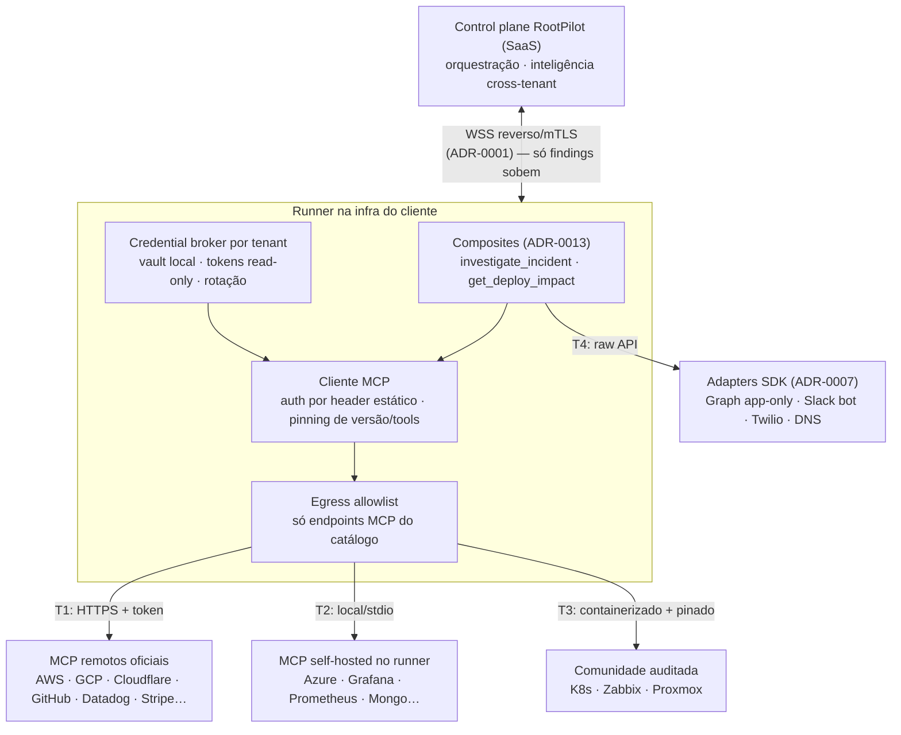

# Estratégia de conectores MCP-first

Como o RootPilot — backend de diagnóstico do NOC ([doc 08](08-integracao-rootpilot.md))
— deve construir sua camada de conectores: **consumindo MCP servers oficiais dos
fornecedores em vez de construir integrações proprietárias**. Curadoria no lugar
de construção.

> Estudo de **11/07/2026**, com pesquisa de mercado em quatro frentes (protocolo,
> IaaS, observabilidade, SaaS/borda/dados); fontes no rodapé. Complementa os ADRs
> do RootPilot: ADR-0006 (open-core: runner + connectors abertos, cérebro
> fechado), ADR-0007 (SDK de connectors de terceiros), ADR-0013 (superfície
> MCP/agente) e ADR-0028 (investigação somente leitura, inviolável).

## Tese

Construir e manter um catálogo de integrações foi o que custou uma década à
Datadog. Em 2025–2026 esse custo colapsou: **os próprios fornecedores passaram a
publicar e manter MCP servers oficiais** — AWS, Google Cloud, Azure, Cloudflare,
GitHub, Datadog, Grafana, Stripe, Atlassian, Elastic, Splunk, PagerDuty e
dezenas de outros. O trabalho da Sunny deixa de ser "escrever o conector do
sistema X" e passa a ser quatro coisas que ninguém entrega junto:

1. **Curadoria** — um catálogo pinado e auditado de servers confiáveis, com o
   tier de confiança de cada um;
2. **Credential brokering no runner** — credenciais read-only por tenant que
   nunca saem da infra do cliente (a tese do ADR-0001);
3. **Enforcement de somente-leitura na credencial**, não na boa vontade do
   server (ver hierarquia abaixo);
4. **Composites correlacionadores** por cima — o valor continua sendo
   `investigate_incident` cruzar os sistemas, não o acesso cru a cada um.

Ponto arquitetural que este estudo confirma: **o MCP fica debaixo dos
composites, não na frente do LLM.** A visão do RootPilot ("em vez de o LLM
orquestrar 8 MCPs crus, chama composites") é exatamente a mitigação que a
própria Anthropic recomenda para os dois maiores problemas operacionais do MCP —
custo de token (schemas de tools chegam a 134k tokens antes da primeira
mensagem; ~1k tokens por tool) e prompt injection via resultados de tool. O
padrão "code execution with MCP" da Anthropic reduziu um workflow de 150k para
2k tokens (−98,7%). O ADR-0013 já estava certo; o MCP é o substrato dos
connectors, não a interface do agente.

## Por que agora é seguro apostar no MCP

| Sinal | Estado (jul/2026) |
|---|---|
| Governança | Doado à **Agentic AI Foundation** (Linux Foundation) em dez/2025 — Anthropic, Block e OpenAI como fundadores; Google, Microsoft, AWS e Cloudflare no suporte. Não é mais protocolo de um vendor |
| Adoção | 97M+ downloads de SDK/mês, 10.000+ servers ativos na doação; cliente MCP nativo em Claude, ChatGPT (Apps SDK é MCP), Gemini e Microsoft Copilot Studio (GA) |
| Spec | Estável **2025-11-25**; revisão **breaking em 28/07/2026** que torna o protocolo stateless (fim de sessões e do handshake `initialize`) |
| Registry | Registry oficial em **preview** (namespaces verificados por DNS/GitHub); **não faz scanning de segurança** — delega ao consumidor |
| Auth M2M | Extensão oficial **OAuth client-credentials** (draft SEP-1046) com suporte nos SDKs TypeScript e Python (JWT-assertion RFC 7523 recomendado) |

A revisão de 28/07/2026 é **boa notícia para o runner** (HTTP puro, sem sticky
session, roteável por gateway — o desenho certo para M2M), mas dita duas regras:
consumir servers **via SDKs oficiais** (que absorvem a migração) e **não
construir server próprio contra o spec antigo** — qualquer server T4 da Sunny
nasce no spec novo. A política formal de deprecação (janelas de 12 meses) reduz
o risco de churn daqui em diante.

## Auth headless: a linha de falha do ecossistema

O fluxo OAuth padrão do MCP pressupõe um humano no navegador. Para um runner
autônomo, o mercado se divide em dois blocos — e essa é a variável que decide
se um sistema entra pelo MCP ou por adapter próprio:

**🟢 Headless resolvido** (API key/token/service account/IAM):

| Sistema | Mecanismo |
|---|---|
| AWS MCP Server (gerenciado, GA mai/2026) | IAM SigV4 — role do agente, zero OAuth |
| Google Cloud (50+ servers gerenciados, Next '26) | Service account via IAM |
| Azure MCP Server (GA nov/2025) | Service principal / managed identity |
| Cloudflare (16+ servers) | API token escopado como Bearer |
| GitHub (remoto GA set/2025) | PAT como Bearer + sufixo `/readonly` |
| Datadog (GA mar/2026) | Service account token ou `DD_API_KEY`+`DD_APPLICATION_KEY` |
| Grafana (self-hosted) | Service account token |
| Elastic Agent Builder (GA Serverless/9.3) | Header `ApiKey` escopado |
| Splunk (app 7931, GA v1.0) | Tokens + RBAC do Splunk |
| New Relic (preview) | User API key |
| PagerDuty (hosted + OSS) | User API token; **read-only por default** |
| Atlassian Rovo MCP (GA fev/2026) | API key de service account (desde mar/2026) |
| Stripe | Restricted key read-only como Bearer — enforcement server-side |
| Supabase / Neon / MongoDB / Redis | PAT / API key / connection string / Atlas service account |

**🔴 Só OAuth interativo** (MCP oficial inutilizável para agente autônomo):

| Sistema | Situação | Fallback (T4) |
|---|---|---|
| Microsoft 365 (Enterprise MCP, preview) | Docs explícitos: "app-only não suportado" — apesar de os escopos incluírem `MCP.ServiceHealth.Read.All` | Graph direto com app-only `ServiceHealth.Read.All` (a API suporta; o wrapper MCP não) |
| Google Workspace (5 servers, preview) | OAuth interativo; **sem cobertura de Admin/Reports/status** | Admin SDK + Status Dashboard direto |
| Slack (GA fev/2026) | OAuth por usuário, só clientes aprovados | Web API clássica com bot token |
| Vercel | OAuth, só clientes aprovados | REST API com token |
| Salesforce (GA abr/2026, EE+) | OAuth+PKCE apenas | REST com JWT-bearer |
| HubSpot (GA abr/2026) | OAuth+PKCE apenas | Private app token + REST |

Estratégia de auth em três camadas, na ordem: (1) **client-credentials/JWT
assertion** onde o server suportar a extensão (os SDKs oficiais já trazem
`ClientCredentialsProvider`/`PrivateKeyJwtProvider`); (2) **token estático
escopado** — o padrão dominante na prática; (3) **adapter raw-API** via SDK do
ADR-0007 para o bloco vermelho.

> **Gotcha de cliente**: alguns clientes MCP iniciam OAuth discovery e ignoram o
> header Bearer estático (documentado no issue #95 do cloudflare/mcp). O cliente
> MCP do runner precisa suportar auth por header fixo de forma confiável — é um
> requisito de implementação, não um detalhe.

## Read-only: hierarquia de enforcement

O ADR-0028 declara a investigação somente-leitura como inviolável. A pesquisa
mostra que **onde** esse enforcement mora importa — e produziu um contraexemplo
instrutivo: a CVE-2026-46519 (CVSS 8.8) no MCP server comunitário de Kubernetes
mais popular, cujo modo read-only era aplicado só na *descoberta* de tools, não
na execução — qualquer cliente podia invocar as tools restritas.

| Nível | Mecanismo | Confiança |
|---|---|---|
| 1. **Credencial** | IAM `ReadOnlyAccess`, RBAC Reader, viewer roles, restricted keys (Stripe), role Postgres read-only (Supabase), Redis ACL `+@read`, PVEAuditor (Proxmox), token read-scoped (Cloudflare/DO/Hetzner) | **Inviolável** — o fornecedor rejeita a escrita mesmo que o server/modelo tente |
| 2. **Flag do server** | `--read-only` (Azure, K8s), `/readonly` (GitHub), `--disable-write` (Grafana), `READ_OPERATIONS_ONLY` (AWS API), `read_only=true` (Supabase), `--readOnly` (MongoDB, **default false**) | Conveniência; **advisory** — vide CVE acima |
| 3. **Filtro de gateway** | Docker MCP Gateway (open source) filtrando o toolset exposto | Complemento para servers sem flag |

**Regra do runner: toda credencial provisionada no onboarding já nasce
read-only (nível 1); flags são defesa em profundidade, nunca a única barreira.**

## Inventário de cobertura (julho/2026)

Tier de curadoria: **T1** = oficial remoto, conectar direto · **T2** = oficial
self-hosted no runner · **T3** = comunidade auditada, credencial hard-limited ·
**T4** = sem MCP viável, adapter próprio (SDK ADR-0007).

### IaaS / infraestrutura

| Sistema | Server | Read-only | Maturidade | Tier |
|---|---|---|---|---|
| AWS | **AWS MCP Server** gerenciado (`aws-mcp.*.api.aws`), 15k+ operações; suite awslabs (CloudWatch etc.) como fallback local — awslabs em modo sucessão para o Agent Toolkit | Via IAM; CloudWatch server é read-only por design | **GA mai/2026**, grátis | T1 |
| Google Cloud | **50+ servers gerenciados** por serviço (ex.: `monitoring.googleapis.com/mcp`); Logging, Monitoring, GKE, Cloud Run, Network diagnostics | IAM viewer roles + Deny policies + `roles/mcp.toolUser` | GA/Preview por serviço | T1 |
| Azure | **Azure MCP Server** (local, stdio/Docker), 47+ serviços, KQL no Log Analytics | Flag `--read-only` + RBAC Reader | **GA nov/2025** (v1.0) | T2 |
| Kubernetes | `containers/kubernetes-mcp-server` (base do OpenShift MCP da Red Hat, Tech Preview) | `--read-only` + **service account com ClusterRole view** (obrigatório — vide CVE-2026-46519 no server concorrente) | v0.0.x, ativo | T3 |
| Terraform | `hashicorp/terraform-mcp-server` | Read-only por default (`ENABLE_TF_OPERATIONS=false`) | **GA jun/2026** (v1.0) | T2 |
| DigitalOcean | Remoto oficial (dez/2025), 9 serviços | Token read-scoped | Produção | T1 |
| Hetzner / Proxmox / VMware | Sem oficial; comunidade (Proxmox: `itunified-io/mcp-proxmox` 44 tools read-only) | Token read-only do projeto / PVEAuditor / role vSphere RO | Comunidade | T3/T4 |
| Docker | MCP Catalog (200+ imagens assinadas) + **MCP Gateway** open source | Gateway filtra toolsets | Produção | infra de curadoria |

### Observabilidade / monitoramento

| Sistema | Server | Read-only | Maturidade | Tier |
|---|---|---|---|---|
| Datadog | Oficial remoto (+ binário local), toolsets apm/ddsql/dbm/k8s/networks read-only | RBAC do service account; toolsets write são opt-in | **GA mar/2026**; ⚠️ quota 50k tool-calls/mês | T1 |
| Grafana | `grafana/mcp-grafana` — **PromQL, LogQL, Pyroscope, alertas, OnCall num conector só** | `--disable-write` + SA token | v0.17.x, muito ativo | T2 |
| Prometheus | `prometheus/prometheus-mcp` (org oficial) | Read-only default; TSDB admin atrás de flag `--dangerous.*` | v0.18 (abr/2026) | T2 |
| Alertmanager | Só comunidade; `rhobs/obs-mcp` (Red Hat) cobre Prom+Thanos+AM+Tempo+Loki | Varia | Comunidade | T3 |
| Elastic | **Agent Builder MCP endpoint** no Kibana (`/api/agent_builder/mcp`); o server antigo foi deprecado | API key escopada a índices `logs-*`/`metrics-*` | **GA** (Serverless/9.3) | T1 |
| Splunk | App oficial 7931, streamable HTTP | Tools read-only + RBAC | **GA v1.0**, v1.2.1 jun/2026 | T2 |
| New Relic | Remoto oficial (`mcp.newrelic.com`) | Read-only por design | **Preview** — reavaliar no GA | T1 (watch) |
| Dynatrace | Gateway remoto oficial (Platform Token); OSS em maintenance | Escopos granulares do token | GA não confirmado | T1 (watch) |
| Sentry | Oficial remoto (`mcp.sentry.dev`) | ⚠️ Sem modo RO; stdio exige escopos de escrita | Produção | T1 com ressalva |
| PagerDuty | Oficial hosted + OSS — **read-only por default, write é flag opt-in** | Melhor default da categoria | Ativo, sem GA formal | T1 |
| Zabbix | **Oficial no roadmap do 8.0 LTS (~Q3/2026)**; até lá comunidade: `mpeirone` (`READ_ONLY=true`) ou initMAX (237 tools, multi-server, tokens escopados — o mais MSP-fit) | Flag + API token | Comunidade madura | T3 → T1 no 8.0 |
| Better Stack / UptimeRobot | Oficiais remotos | Sem modo RO — escopar o token | Recentes | T1 com ressalva |

### SaaS / borda / dados

| Sistema | Server | Read-only | Maturidade | Tier |
|---|---|---|---|---|
| Cloudflare | **16+ servers oficiais** — o fit perfeito para o NOC: GraphQL analytics (eventos de WAF/firewall — "o WAF está bloqueando o checkout?"), Observability, Logpush, DNS Analytics, Audit Logs, Radar (outages da internet) | API token read-scoped | Produção | T1 |
| GitHub | Oficial remoto — o modelo de referência: `api.githubcopilot.com/mcp/readonly` + PAT fine-grained | Sufixo `/readonly` tem precedência sobre tudo | **GA set/2025** | T1 |
| Atlassian | Rovo MCP (Jira/Confluence/JSM) | Permissões do service account | **GA fev/2026**, headless desde mar/2026 | T1 |
| Stripe | `mcp.stripe.com` — server só registra tools compatíveis com a restricted key | Restricted key read-only, enforcement server-side | GA (core) | T1 |
| Supabase / Neon | Oficiais remotos | `read_only=true` executa como **role Postgres read-only real** (Supabase — melhor da classe) / `?readonly=true` (Neon) | Produção | T1 |
| MongoDB / Redis | Oficiais locais | `--readOnly` (setar explicitamente!) / Redis ACL | GA / v0.5 | T2 |
| PostgreSQL genérico | **Sem oficial** — o reference server da Anthropic foi **arquivado em jul/2025 e ainda tem ~21k installs/semana + SQL injection documentado. Não usar.** | Role read-only no banco + server mantido (pgEdge, DBHub) | — | T2/T3 |
| M365 / Workspace / Slack / Salesforce / HubSpot | Oficiais existem mas **só OAuth interativo** (tabela vermelha acima) | — | — | **T4** |
| Twilio | Hosted é só busca de docs ("não executa API calls"); `twilio-labs/mcp` (alpha) cobre a API com API key | Restricted keys (beta) | Alpha | T4 — REST direto p/ diagnosticar paging do GoAlert |
| DNS/registrars | Nada oficial dominante | Lookups são read-only por natureza | — | T4 — **wrapper próprio de `dig`/DoH/RDAP** (mais confiável que comunidade; candidato a MCP server open da Sunny) |
| GoAlert | Sem MCP (é o on-call empacotado pela Sunny, doc 07) | — | — | T4 leve — API GraphQL própria |

## Arquitetura: o runner como cliente MCP + credential broker

Decisões de desenho que a pesquisa sustenta:

1. **Threat model nº 1: prompt injection via resultado de tool.** Um agente de
   diagnóstico ingere logs, tickets e telemetria — todos influenciáveis por
   atacante (casos reais: GitHub Issues maliciosas vazando repos privados,
   incidente Supabase/Cursor). Mitigação em camadas: credenciais read-only
   (dano limitado a vazamento de leitura), egress allowlist (exfiltração
   bloqueada), composites que extraem dados estruturados em vez de despejar
   texto cru no contexto, e os tetos de tool-calls/tokens que o F3 do ADR-0028
   já tem.
2. **Pinning contra rug-pull**: versão do server + hash das tool descriptions
   registrados na aprovação de catálogo; mudança de description = re-aprovação.
   O registry oficial não faz scanning (by design) — o catálogo privado da
   Sunny é a barreira. Casos que justificam: backdoor `postmark-mcp` (~300 orgs
   afetadas, set/2025), >30% de 1.800 servers pesquisados com vulnerabilidade
   explorável, RCEs no Git MCP da própria Anthropic (jan/2026).
3. **T3 sempre containerizado e vendorizado** — código auditado uma vez, imagem
   pinada por digest, atualização é PR revisado, nunca `latest`.
4. **Um conector por stack observável, não um por ferramenta**: onde o cliente
   tem Grafana na frente do Prometheus/Loki, `mcp-grafana --disable-write` cobre
   métricas + logs + alertas com um token só.

## Método: o Pareto da carteira

O catálogo não se define em abstrato — se define pela carteira. Processo:

1. **Levantar no onboarding** ([doc 05](05-onboarding-cliente.md)) o stack de
   cada cliente: sistema, criticidade para incidentes, credencial read-only
   possível, tier do conector. Vira uma coluna do runbook de onboarding.
2. **Hipótese a validar com dados da Sunny**: nuvem (1–2 providers) +
   Kubernetes + 1 stack de observabilidade + Cloudflare + GitHub + M365 ou
   Workspace + 1–2 bancos gerenciados + DNS devem cobrir ~90% dos incidentes
   com **15–20 conectores no total**.
3. **Regra de corte**: conector entra no catálogo quando ≥2 clientes usam o
   sistema, ou 1 cliente enterprise o exige em contrato. Fora disso, o
   incidente segue o triage manual do nível 2 clássico (doc 07) — não vale o
   custo de auditoria de um T3 para um cliente só.

## Leitura competitiva

1. **Para a resolve.ai, MCP é escape hatch** ("custom tooling via MCP, APIs e
   webhooks" no fim da página de integrações); as integrações núcleo deles são
   observabilidade profunda single-company. Para a Sunny, MCP é o **substrato**
   da camada de conectores — o que muda o pitch de "temos N integrações" para
   "diagnosticamos a camada que eles ignoram (SaaS/borda/multi-nuvem
   heterogênea), sem que credenciais saiam de casa, para a carteira inteira".
2. **O catálogo curado é asset de venda**: a resposta ao security questionnaire
   vira "todo acesso de diagnóstico é read-only por credencial, com egress
   allowlist e catálogo pinado — aqui está a lista". Nenhum concorrente
   consegue afirmar isso hoje.
3. **Open-core (ADR-0006) ganha um canal novo**: os adapters T4 que a Sunny
   construir (DNS diagnostics, M365 service health headless, GoAlert) podem ser
   publicados como MCP servers oficiais da Sunny no registry e no Docker MCP
   Catalog — distribuição e marca para o RootPilot, exatamente onde o
   ecossistema tem lacunas reconhecidas.

## Riscos

| Risco | Mitigação |
|---|---|
| Spec breaking 28/07/2026 (stateless) | Consumir via SDKs oficiais; servers T4 próprios nascem no spec novo; janela de deprecação de 12 meses |
| Server comunitário comprometido (supply chain) | Tiers + vendorização + pinning por digest + credencial read-only como última linha |
| Prompt injection via logs/telemetria | Read-only + egress allowlist + composites estruturados + budget do F3 |
| Quotas de vendors (Datadog 50k calls/mês) | Orçamento de tool-calls por investigação (F3 já prevê); cache de resultados no composite |
| Vendors 🔴 nunca abrirem auth headless no MCP | Adapters T4 via raw API já resolvem hoje; MCP vira upgrade, não dependência |
| Servers preview mudarem (New Relic, M365, GCP parcial) | Watch-list com reavaliação trimestral; catálogo marca maturidade por conector |

## Roadmap recomendado

1. **Fase A — piloto (alinha com o piloto do NOC)**: 5–6 conectores T1/T2 para
   o primeiro tenant: AWS MCP gerenciado (role read-only), Grafana **ou**
   Datadog (conforme o cliente), Cloudflare, GitHub `/readonly`, adapter
   GoAlert (GraphQL). Enforcement 100% por credencial; auth por token estático.
2. **Fase B (+1 mês)**: formalizar o credential broker (vault por tenant,
   rotação, provisionamento read-only no onboarding do doc 05), egress
   allowlist e catálogo pinado com hash de tool descriptions. Migrar SDKs para
   o spec 2026-07-28.
3. **Fase C (+2–3 meses)**: adapters T4 — Graph app-only (service health M365),
   Slack bot reads, Twilio (diagnóstico do paging), wrapper DNS. Reavaliar
   Zabbix quando o 8.0 LTS sair. Publicar o primeiro MCP server open da Sunny
   (candidato: DNS diagnostics).
4. **Fase D**: adotar client-credentials/JWT-assertion nos servers que
   suportarem a extensão; avaliar um gateway MCP (Docker MCP Gateway vs.
   próprio) como ponto único de enforcement/auditoria multi-tenant no runner.

## Fontes

**Protocolo e governança**: [spec 2025-11-25 changelog](https://modelcontextprotocol.io/specification/2025-11-25/changelog) ·
[RC 2026-07-28 (breaking)](https://blog.modelcontextprotocol.io/posts/2026-07-28-release-candidate/) ·
[doação à Agentic AI Foundation](https://www.anthropic.com/news/donating-the-model-context-protocol-and-establishing-of-the-agentic-ai-foundation) ·
[extensão OAuth client-credentials](https://modelcontextprotocol.io/extensions/auth/oauth-client-credentials) ·
[MCP Registry](https://modelcontextprotocol.io/registry/about) ·
[code execution with MCP (Anthropic)](https://www.anthropic.com/engineering/code-execution-with-mcp)

**IaaS**: [AWS MCP Server GA](https://aws.amazon.com/blogs/aws/the-aws-mcp-server-is-now-generally-available/) ·
[Agent Toolkit for AWS](https://github.com/aws/agent-toolkit-for-aws) ·
[Google-managed MCP servers](https://cloud.google.com/blog/products/ai-machine-learning/google-managed-mcp-servers-are-available-for-everyone) ·
[Azure MCP Server](https://github.com/Azure/azure-mcp) ·
[kubernetes-mcp-server](https://github.com/containers/kubernetes-mcp-server) ·
[Terraform MCP GA](https://www.hashicorp.com/en/blog/terraform-mcp-server-is-now-generally-available) ·
[CVE-2026-46519 (bypass de read-only)](https://www.manifold.security/blog/mcp-server-kubernetes-readonly-bypass) ·
[Docker MCP Gateway](https://github.com/docker/mcp-gateway)

**Observabilidade**: [Datadog MCP Server](https://docs.datadoghq.com/mcp_server/) ·
[grafana/mcp-grafana](https://github.com/grafana/mcp-grafana) ·
[prometheus/prometheus-mcp](https://github.com/prometheus/prometheus-mcp) ·
[Elastic Agent Builder MCP](https://www.elastic.co/docs/explore-analyze/ai-features/agent-builder/mcp-server) ·
[Splunk MCP (app 7931)](https://splunkbase.splunk.com/app/7931) ·
[New Relic MCP](https://docs.newrelic.com/docs/agentic-ai/mcp/overview/) ·
[PagerDuty MCP](https://github.com/PagerDuty/pagerduty-mcp-server) ·
[roadmap Zabbix 8.0](https://www.zabbix.com/roadmap)

**SaaS/borda/dados**: [servers da Cloudflare](https://developers.cloudflare.com/agents/model-context-protocol/mcp-servers-for-cloudflare/) ·
[GitHub remote MCP GA](https://github.blog/changelog/2025-09-04-remote-github-mcp-server-is-now-generally-available/) ·
[M365 MCP (sem app-only)](https://learn.microsoft.com/en-us/graph/mcp-server/overview) ·
[Atlassian Rovo MCP + API token](https://community.atlassian.com/forums/Atlassian-Remote-MCP-Server/Announcing-authentication-via-API-token-for-Atlassian-Rovo-MCP/ba-p/3197014) ·
[Stripe MCP](https://docs.stripe.com/mcp) ·
[Supabase MCP](https://supabase.com/docs/guides/ai-tools/mcp) ·
[Postgres MCP arquivado + SQL injection](https://securitylabs.datadoghq.com/articles/mcp-vulnerability-case-study-SQL-injection-in-the-postgresql-mcp-server/)

**Segurança**: [State of MCP Security 2026](https://pipelab.org/blog/state-of-mcp-security-2026/) ·
[estudo: >30% de servers vulneráveis](https://www.mdpi.com/2624-800X/6/3/84) ·
[backdoor postmark-mcp](https://www.practical-devsecops.com/mcp-security-statistics-2026-report/)
